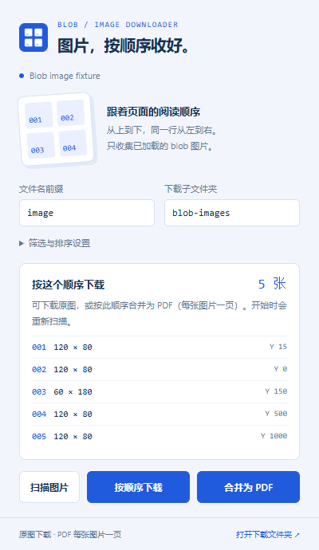

# Blob 图片顺序下载与 PDF 合并

[English](README.md) · **简体中文**

一个 Chrome / Edge 浏览器扩展：收集当前网页中已加载、可见的 **blob 图片**，按阅读顺序下载原图，或将全部图片合并为 **一个 PDF，每张图片一页**。

当前版本 **1.1.0** · Manifest V3 · 本地处理 · 无需构建



## 功能

| | 下载原图 | 合并为 PDF |
| --- | --- | --- |
| 输出 | 每张图片独立保存，依次编号 | 整批图片合并成一个 PDF |
| 顺序 | 从上到下，同一行从左到右 | 沿用相同顺序，每张图片一页 |
| 图片处理 | 保留原始字节与格式 | JPEG 直接嵌入；其他可解码格式转为 PNG |
| 尺寸 | 保留原始图片尺寸 | 按每张图片的宽高比设置页面 |
| 关闭弹窗 | 继续下载 | 继续处理和保存 |
| 图片失败 | 其他图片仍可继续下载 | 停止合并，避免导出缺页 PDF |

支持主页面、同源 iframe 及嵌套框架中的图片。插件界面为简体中文。

## 安装与更新

1. 点击 GitHub 页面上的 **Code → Download ZIP** 并解压，或克隆仓库：

   ```sh
   git clone https://github.com/gulzxeric/blob-image-downloader.git
   ```

2. Chrome 打开 `chrome://extensions`；Edge 打开 `edge://extensions`。
3. 开启「开发者模式」，点击「加载已解压的扩展程序」。
4. 选择仓库中的 **`extension` 文件夹**，其中直接包含 `manifest.json`。
5. 将扩展固定到工具栏，方便使用。

已经从这个文件夹加载过扩展时，更新文件后，在扩展管理页点击该扩展的「重新加载」按钮即可。安装使用不需要 Node.js 或 npm。

也可以使用 [Releases](https://github.com/gulzxeric/blob-image-downloader/releases) 中已有的扩展 ZIP：解压后选择直接包含 `manifest.json` 的文件夹。安装前检查版本号；当前源码版本为 1.1.0。

## 使用

1. 打开需要保存图片的网页，先滚动页面，让需要的图片加载出来。
2. 点击工具栏的扩展图标，再点击「**扫描图片**」，检查数量、尺寸和排列顺序。
3. 按需修改文件名前缀、下载子文件夹或筛选设置。修改后重新扫描。
4. 保存独立图片时点击「**按顺序下载**」；保存为一个文档时点击「**合并为 PDF**」。两种操作都会在开始前重新扫描页面。
5. 在弹窗查看进度，鼠标悬停在失败条目上可查看原因。「打开下载文件夹」可打开浏览器下载目录。

默认设置下的输出示例：

```text
Downloads/blob-images/
  20261025-153000-a12b34/   # 原图下载批次
    image_001.png
    image_002.jpg
    image_003.webp
  20261025-153100-c56d78/   # PDF 合并批次
    image.pdf
```

每次操作使用独立的批次文件夹。主下载目录由浏览器设置决定。

收集图片期间，请保持来源页面打开。关闭插件弹窗不会停止任务，重新打开可查看当前会话的进度；刷新、关闭或离开来源页面可能中断尚未处理的图片。

「**停止提交**」阻止后续原图进入下载队列，已经交给浏览器的下载仍继续。「**停止合并**」停止 PDF 图片收集，并丢弃未完成的文档。合并失败或停止时不会导出缺页 PDF；处理问题后重新扫描并合并即可。

## PDF 合并规则

- 每张图片占一页。横图和竖图可以混排，保持各自宽高比，无裁切、不拉伸。
- 按原图尺寸以 96 像素/英寸设置页面；超过 PDF 页面尺寸限制时，仅等比缩小页面和绘制尺寸，不缩减图片像素。
- JPEG 原始数据直接嵌入，不重新压缩。其他格式由浏览器解码后转为 PNG，保留透明度；动图使用首帧。
- 所有图片成功加入后才生成 PDF。弹窗会分别显示图片处理进度和最终 PDF 的保存状态。
- PDF 库随扩展打包，所有处理都在本机完成，不上传图片、不加载远程脚本。

## 筛选、顺序与限制

仅收集 `src` 以 `blob:` 开头的 `` 元素。图片必须已加载、有布局尺寸，且自身和祖先元素可见。已加载但位于屏幕之外的图片也会收集；隐藏、完全透明、跨域或不允许同源访问的沙盒框架中的图片会排除。

先按文档纵坐标排序，再按行分组，行内从左到右。每行以最上方图片的位置为锚点，默认同行容差为 20 px。同一个 blob URL 出现在多个符合条件的图片元素中时，每次出现均独立编号。

| 设置或限制 | 数值 |
| --- | --- |
| 最小原始尺寸 | 默认宽、高都严格大于 50 px，可调整 |
| 同行容差 | 默认 20 px，可在 0–200 px 间调整 |
| 提交间隔 | 默认 300 ms，可在 100–3000 ms 间调整 |
| 原始图片大小 | 两种模式均限制每张不超过 24 MiB |
| PDF 单图像素 | 不超过 4000 万像素 |
| PDF 整批大小 | 累计不超过 256 MiB，按每张原文件与转码后文件大小的较大值计算 |

原图下载保持字节不变。PNG、JPEG、WebP、GIF、AVIF、BMP 根据文件头识别；其他支持格式使用已声明的 MIME，未知格式使用 `.bin`。

插件不会自动滚动或等待懒加载，不收集普通 HTTP 图片和 CSS 背景图，不进入 Shadow DOM。被撤销的 blob URL 可能读取失败，即使图片仍显示在页面上。浏览器内部页面和扩展商店页面无法扫描；本地文件网页需要在扩展设置中开启「允许访问文件网址」。

进度仅保留在当前浏览器会话中，浏览器重启后不恢复未完成的批次。浏览器下载策略仍可能阻止或中断保存。

## 权限与隐私

| 权限 | 用途 |
| --- | --- |
| `activeTab` | 点击扩展后临时访问所选网页 |
| `scripting` | 在该页面及可访问的同源 iframe 中收集并读取 blob 图片 |
| `downloads` | 保存原图或 PDF，并跟踪实际下载结果 |
| `storage` | 本地保存设置，以及当前会话的任务元数据 |
| `offscreen` | 在隐藏的扩展页面中解码图片、合成 PDF、管理临时下载 Blob URL |

不申请持续访问全部网站的权限，没有分析统计、广告、远程可执行代码或开发者上传接口。图片和 PDF 数据在处理时保留于浏览器内存；扩展存储只保存设置和任务元数据。详见 [隐私政策](PRIVACY.md)。

## 开发与测试

需要 Node.js 22 或更新版本：

```sh
npm ci
npm run check
npm test
npx playwright install chromium
npm run test:e2e
npm run package
```

`npm run package` 生成 **`dist/blob-image-downloader-v1.1.0.zip`**，ZIP 根目录直接包含 `manifest.json`。源码无需构建即可加载。PDF 依赖和许可证位于 [extension/vendor](extension/vendor/README.md)。

浏览器测试使用独立临时配置和本地测试页。测试副本临时增加 localhost 权限，以模拟点击工具栏后获得的页面访问权；发布 manifest 不包含该权限。测试可能在测试浏览器的下载目录生成 `blob-images-e2e` 文件夹。如需使用本机已有的兼容 Chromium，可设置环境变量 `PLAYWRIGHT_CHROMIUM_EXECUTABLE`。

测试覆盖 iframe 图片发现、可见性筛选、阅读顺序、原图字节、失效 URL、停止操作、关闭弹窗继续运行，以及 PDF 页数与颜色、JPEG 字节保留、WebP 转换、透明度和横竖页面比例。

## 项目结构

| 路径 | 内容 |
| --- | --- |
| `extension/` | 可直接加载的扩展源码 |
| `tests/` | 单元测试、浏览器测试和本地测试页 |
| `scripts/` | 检查、ZIP 打包和素材生成脚本 |
| `docs/` | 插件弹窗截图 |
| `store/` | 商店文案、权限说明和审核测试指引 |

版本变化见 [更新记录](CHANGELOG.md)，商店材料见 [store/README.md](store/README.md)。问题反馈请使用 [GitHub Issues](https://github.com/gulzxeric/blob-image-downloader/issues)。

## 许可证

[MIT](LICENSE) © 2026 gulzxeric。随附第三方库的许可声明位于 `extension/vendor`。
